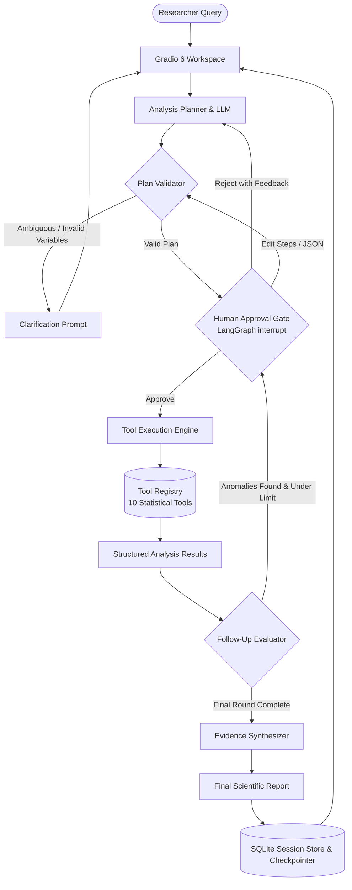
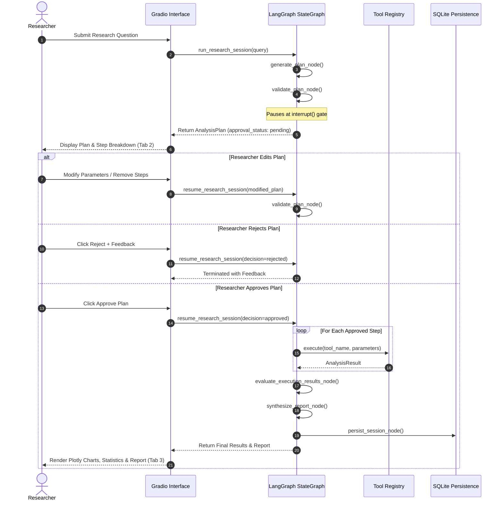

# NeuroFlow AI: Agentic Experimental Data Analysis Platform

[](https://www.python.org/downloads/)
[](https://github.com/langchain-ai/langgraph)
[](https://gradio.app/)
[](LICENSE)
[]()

**NeuroFlow AI** is an agentic, human-in-the-loop data analysis prototype designed for experimental cognitive neuroscience and memory-task studies (e.g., Unity3D desktop/VR experiments conducted at DZNE).

NeuroFlow translates natural-language researcher queries into structured, multi-step analysis plans, executes deterministic statistical workflows, renders interactive Plotly visualizations, synthesizes evidence-grounded scientific reports, and maintains complete SQLite audit logs—**strictly requiring human approval before executing any data-processing tool**.

---

## 📑 Table of Contents

1. [Key Features](#-key-features)
2. [System Architecture](#-system-architecture)
3. [Quickstart: Local Installation](#-quickstart-local-installation)
4. [Containerized Deployment (Docker & Compose)](#-containerized-deployment-docker--compose)
5. [Researcher Walkthrough (UI Guide)](#-researcher-walkthrough-ui-guide)
6. [Section 10 Representative Evaluation Suite](#-section-10-representative-evaluation-suite)
7. [Mock-Data Boundary & Real Analysis Replacement](#-mock-data-boundary--real-analysis-replacement)
8. [Known Limitations & Security Considerations](#-known-limitations--security-considerations)
9. [Repository Structure](#-repository-structure)
10. [Test Suite & Verification](#-test-suite--verification)

---

## 🌟 Key Features

- **Strict Human-in-the-Loop Gate:** Powered by native LangGraph `interrupt()`. No statistical tool, script, or computational pipeline ever executes autonomously without explicit researcher approval or modification.
- **Structured Multi-Level Plan Validation:** All proposed analysis plans are validated against a strict Pydantic contract and tool registry to eliminate hallucinated tools, illegal parameters, circular dependencies, and out-of-scope variables.
- **Clarification & Refusal Engine:** Ambiguous research questions, out-of-vocabulary variables (e.g. physiological sensors not in the experiment's data dictionary), and unsupported complex ML workflows trigger actionable clarification dialogues rather than erroneous executions.
- **10 Deterministic Analytical Tools:** Complete statistical and exploratory tool library returning standardized `AnalysisResult` envelopes with summary statistics, Plotly chart data, filter metadata, scientific interpretations, and limitations.
- **Interactive Gradio 6 Interface:** Four dedicated workspaces: Research Workspace, Plan Review & Approval Gate, Evidence & Chart Synthesis, and Historical Session Audit.
- **Bounded Iterative Analysis:** Intelligently evaluates executed results and suggests justified follow-up rounds (e.g. data quality anomalies or strong cohort contrasts) subject to strict iteration limits and mandatory human approval gates.
- **Robust Persistence & Auditing:** Embedded SQLite checkpointer and session repository preserving execution logs, timestamps, parameters, plans, approval decisions, and generated reports.

---

## 🏗 System Architecture

NeuroFlow combines **FastAPI/Gradio 6**, a **LangGraph StateGraph**, a deterministic **LLM Planning & Validation Engine**, and a **Statistical Tool Registry**:



### LangGraph Workflow & State Lifecycle



---

## 🚀 Quickstart: Local Installation

### Prerequisites

- **Python:** 3.11 or 3.12 (Python 3.12 recommended)
- **Git**
- *(Optional)* **Ollama** if running local LLMs (defaults to deterministic fake model for zero-dependency offline runs).

### 1. Clone & Set Up Virtual Environment

```bash
git clone https://github.com/your-username/NeuroFlow.git
cd NeuroFlow

# Create virtual environment
python -m venv .venv

# Activate virtual environment
# On Linux/macOS:
source .venv/bin/activate
# On Windows PowerShell:
.\.venv\Scripts\Activate.ps1
```

### 2. Install Dependencies

Install the package in editable mode along with runtime and test dependencies:

```bash
pip install -e ".[dev]"
```

### 3. Configure Environment

Copy the example configuration file:

```bash
# On Linux/macOS:
cp .env.example .env
# On Windows:
copy .env.example .env
```

The default settings run in **deterministic offline mode** (`LLM_PROVIDER=fake`), requiring no external API keys or network access:

```env
LLM_PROVIDER=fake
LLM_MODEL=mock-model
LLM_TEMPERATURE=0.0
SQLITE_DB_PATH=data/neuroflow.db
GRADIO_SERVER_NAME=127.0.0.1
GRADIO_SERVER_PORT=7860
```

### 4. Run the Test Suite

Verify that all 98 unit, graph, UI, evaluation, and end-to-end tests pass:

```bash
pytest
```

### 5. Launch the Application

```bash
python -m neuroflow.ui.app
```

Open your browser to: **[http://localhost:7860](http://localhost:7860)**

---

## 🐳 Containerized Deployment (Docker & Compose)

NeuroFlow is packaged for containerized deployment with an air-gapped configuration (telemetry and remote font dependencies disabled).

### Option A: Using Docker Compose (Recommended)

To build and start the container with persistent SQLite volume mounting:

```bash
docker compose up --build
```

Access the UI at: **[http://localhost:7860](http://localhost:7860)**

To shut down:
```bash
docker compose down
```

### Option B: Using Standalone Docker

```bash
# Build the image
docker build -t neuroflow-ai:latest .

# Run the container with local data persistence
docker run -d \
  -p 7860:7860 \
  -v "$(pwd)/data:/app/data" \
  --name neuroflow-ai \
  neuroflow-ai:latest
```

---

## 🔬 Researcher Walkthrough (UI Guide)

The NeuroFlow interface is organized into 4 intuitive tabs:

### Tab 1: Research Workspace

1. **Active Experiment Context:** Displays metadata for the active dataset (`EXP-DZNE-MEM-001`, *Immersive VR Object-Location Spatial Memory Task*), including 80 participants, cohort split (40 healthy controls, 40 early MCI), 120 trials/session, and available variables.
2. **Quick-Fill Demo Queries:** Click any of the 10 pre-configured buttons to instantly populate representative research questions covering group comparisons, learning curves, correlations, clustering, and clarifications.
3. **Submission:** Click **"Generate Analysis Plan"** to initiate the planning agent. If the query is ambiguous or references missing variables, an interactive clarification alert is rendered with suggested alternatives.

### Tab 2: Analysis Plan & Human Approval Gate

1. **Plan Summary & Metadata:** Review the generated plan ID, rationale, estimated runtime, and structured steps.
2. **Step Review:** Inspect each tool's name, purpose, input parameters, and scientific rationale.
3. **Step Customization:** Remove optional steps via the multi-select dropdown or switch to the **Plan JSON Editor** to fine-tune raw parameters.
4. **Approval Gate Actions:**
   - **Approve Plan:** Authorizes the LangGraph workflow to resume and execute the approved tools.
   - **Reject Plan:** Halts execution and returns feedback to the planning engine.

### Tab 3: Results & Evidence Synthesis

1. **Step Execution Audit Log:** Real-time log showing tool execution timestamps, parameters passed, and completion status.
2. **Interactive Visualizations:** Up to 4 high-resolution Plotly charts dynamically rendered based on the tool outputs (e.g. Group Comparison Bar Charts, Trial-by-Trial Learning Curves, Response Time Histograms, Feature Scatter Plots).
3. **Detailed Metrics:** Structured summaries of effect sizes ($t$, $p$, Cohen's $d$), cluster silhouettes, regression coefficients ($R^2$, RMSE), and data quality percentages.
4. **Evidence-Grounded Synthesis:** Scientific executive summary and narrative report referencing only verified tool findings.
5. **Mandatory Mock Notice:** Prominent banner indicating synthetic demo data limitations.

### Tab 4: Session History & Audit

1. **Session Browser:** Search and browse previous analysis sessions by session ID, query keywords, or status.
2. **Full Audit Inspection:** Inspect the recorded plan, approval decision, executed tools, raw outputs, and synthesized report for any past session.

---

## 📊 Section 10 Representative Evaluation Suite

NeuroFlow includes a test suite covering the 10 representative research requests specified in Section 10 of the system specification:

| Case # | Query Focus | Expected Planner & Workflow Behavior |
|:---:|:---|:---|
| **Case 1** | **Group Comparison**<br/>*"Compare memory accuracy between the control and experimental groups."* | Proposes `validate_experiment_data` followed by `compare_experimental_groups` ($t$-test, Cohen's $d$). |
| **Case 2** | **Learning Progression**<br/>*"Examine learning progression over repeated trials for participants."* | Proposes `validate_experiment_data` followed by `analyze_learning_curve` across blocks 1–4. |
| **Case 3** | **RT & Error Correlation**<br/>*"Investigate whether response time is associated with error rate."* | Proposes `analyze_performance_correlations` (Pearson $r$, Spearman $\rho$, scatter matrix). |
| **Case 4** | **Task Difficulty**<br/>*"Identify which memory tasks have the lowest accuracy and highest difficulty."* | Proposes `analyze_task_difficulty` (rank-orders tasks by error rate and cognitive load). |
| **Case 5** | **Anomalous Sessions**<br/>*"Find unusual or anomalous sessions with high latency or incomplete blocks."* | Proposes `detect_anomalous_sessions` (flags sessions $> 2.5\sigma$ latency or timeout rates). |
| **Case 6** | **Behavioural Clustering**<br/>*"Cluster participants by behavioural strategy and response features."* | Proposes `cluster_participant_behaviour` (unsupervised $k$-means clustering, silhouette score). |
| **Case 7** | **Supervised Prediction**<br/>*"Predict high task accuracy classification based on response time and attempt count."* | Proposes `predict_task_performance` (supervised regression / classifier performance evaluation). |
| **Case 8** | **Ambiguous Query**<br/>*"do some analysis on the participants"* | Refuses immediate plan; issues `ClarificationNeeded` prompt asking for cognitive focus. |
| **Case 9** | **Unknown Variable**<br/>*"Compare participant blood_pressure and galvanic response between groups."* | Rejects unknown physiological variables; suggests available cognitive metrics (`accuracy`, `response_time_ms`). |
| **Case 10** | **Unsupported Analysis**<br/>*"Train a custom deep neural network in PyTorch to diagnose cognitive impairment."* | Refuses unsupported deep learning execution; recommends standard behavioural tools. |

---

## 🔌 Mock-Data Boundary & Real Analysis Replacement

NeuroFlow strictly decouples **data contracts & orchestration** from **computational implementations**:

```
src/neuroflow/
├── schemas/                <-- STRICT CONTRACT (Immutable Pydantic Interfaces)
│   ├── analysis.py         <-- Common AnalysisResult envelope & ChartData
│   └── planning.py         <-- AnalysisStep, AnalysisPlan, ClarificationNeeded
└── tools/
    ├── registry.py         <-- Safe Tool Registry & dispatch
    └── *.py                <-- ANALYSIS IMPLEMENTATIONS (Mock -> Real)
```

### Steps to Replace Mock Tools with Real Scientific Code

1. **Keep the Pydantic Signature Intact:**
   Each tool accepts a validated Pydantic parameter model and returns an `AnalysisResult`:
   ```python
   def analyze_memory_performance(params: MemoryPerformanceParams) -> AnalysisResult:
       # ...
   ```
2. **Replace Synthetic Math with Scientific Libraries:**
   Import `pandas`, `scipy.stats`, `statsmodels`, or `pingouin`:
   ```python
   import pandas as pd
   from scipy import stats

   # Load real experimental trial data (e.g. CSV, Parquet, or SQLite)
   df = pd.read_parquet("data/exp_dzne_mem_001_trials.parquet")
   
   # Compute actual descriptive & inferential statistics
   t_stat, p_val = stats.ttest_ind(
       df[df['group'] == 'control']['accuracy'],
       df[df['group'] == 'experimental']['accuracy']
   )
   ```
3. **Format Standardized Plotly Figures:**
   Generate standard Plotly JSON dicts (`fig.to_dict()`) and assign to `chart_data`.
4. **Remove Demo Notice in Production:**
   Update `limitations` to reflect real statistical power, sample attrition, and normality tests.

---

## 🛡 Known Limitations & Security Considerations

### Known Limitations

1. **Deterministic Mock Calculations:** Statistical values, $p$-values, effect sizes, and cluster assignments are deterministic synthetic placeholders designed for safe demonstration without requiring raw patient data.
2. **Single-Node SQLite Storage:** Session state and LangGraph checkpoints use SQLite. Suitable for single-machine workstation and lab server environments; multi-node scaling would require PostgreSQL.
3. **Single Active Experiment Context:** The current prototype defaults to dataset `EXP-DZNE-MEM-001`. Multi-study support requires passing custom `ExperimentContext` schemas.

### Security & Reproducibility Safeguards

- **No Arbitrary Code Execution:** The agent does **not** generate or execute dynamic Python strings (`eval`, `exec`) or unsanitized shell commands. Only pre-registered, strictly-typed tools in `ToolRegistry` can be invoked.
- **Air-Gapped & Offline Ready:** Gradio telemetry and HuggingFace Hub network checks are explicitly disabled (`GRADIO_ANALYTICS_ENABLED=False`, `HF_HUB_OFFLINE=1`).
- **Audit Immutability:** Execution parameters, timestamps, researcher approval decisions, and generated reports are logged to the SQLite database for compliance and scientific reproducibility.

---

## 📁 Repository Structure

```text
NeuroFlow/
├── .dockerignore                 # Docker build exclusions
├── .env.example                  # Environment configuration template
├── .gitignore                    # Git tracking exclusions
├── Dockerfile                    # Containerization specification (python:3.12-slim)
├── docker-compose.yml            # Docker Compose orchestration
├── pyproject.toml                # Project metadata, dependencies & pytest config
├── README.md                     # Comprehensive project documentation
├── README_NeuroFlow_AI.md        # Original prototype specification
├── data/                         # Local database and persistent SQLite store
├── src/
│   └── neuroflow/
│       ├── config.py             # Pydantic-settings configuration
│       ├── agent/
│       │   ├── graph.py          # LangGraph StateGraph definition & entrypoints
│       │   ├── llm.py            # LLM provider factory (fake, ollama, openai, anthropic)
│       │   ├── nodes.py          # Workflow nodes (planning, validation, execution, synthesis)
│       │   ├── prompts.py        # Structured system prompts and few-shot templates
│       │   ├── routing.py        # Conditional edges (approval, iterative follow-up)
│       │   ├── state.py          # Typed GraphState definitions
│       │   └── validator.py      # Multi-level plan validation rules
│       ├── data/
│       │   └── experiment_context.py # EXP-DZNE-MEM-001 metadata & data dictionary
│       ├── persistence/
│       │   ├── database.py       # SQLite connection manager & DDL schemas
│       │   └── sessions.py       # ResearchSession CRUD & audit repository
│       ├── schemas/
│       │   ├── analysis.py       # AnalysisResult envelope & chart models
│       │   ├── experiment.py     # ExperimentContext, variable & cohort schemas
│       │   ├── planning.py       # AnalysisPlan, Step & Clarification schemas
│       │   └── session.py        # ExecutionRecord, FinalReport & Approval schemas
│       ├── tools/
│       │   ├── base.py           # Base tool parameter contract
│       │   ├── behavioral.py     # cluster_participant_behaviour, predict_task_performance
│       │   ├── data_quality.py   # validate_experiment_data, detect_anomalous_sessions
│       │   ├── group_analysis.py # compare_experimental_groups, correlations, difficulty
│       │   ├── performance.py    # memory_performance, learning_curve, response_time
│       │   └── registry.py       # Tool registry mapping names to functions
│       └── ui/
│           ├── app.py            # Gradio 6 Blocks web application
│           └── components.py     # Markdown & Plotly UI formatting helpers
└── tests/
    ├── evaluation/
    │   ├── test_e2e_pipeline.py  # End-to-end lifecycle verification (request -> report)
    │   └── test_planning_cases.py# Section 10 10-case evaluation suite
    ├── integration/
    │   ├── test_graph.py         # LangGraph approval gate & interrupt tests
    │   └── test_iterative_analysis.py # Multi-round follow-up & limits tests
    └── unit/
        ├── test_persistence.py   # SQLite session repository unit tests
        ├── test_planner.py       # LLM factory & plan validator unit tests
        ├── test_registry.py      # Tool registry unit tests
        ├── test_schemas.py       # Pydantic schema serialization unit tests
        ├── test_tools.py         # Statistical analysis tools unit tests
        └── test_ui.py            # Gradio UI components and smoke tests
```

---

## 🧪 Test Suite & Verification

The test suite covers unit contracts, schema validation, graph routing, approval interrupts, iterative follow-up analysis, UI components, Section 10 evaluation cases, and full end-to-end execution:

```bash
# Run all tests
pytest

# Run with verbose output
pytest -v

# Run only Section 10 evaluation tests
pytest tests/evaluation/ -v

# Run only integration tests
pytest tests/integration/ -v
```

All 98 tests pass with 100% deterministic reproducibility.
